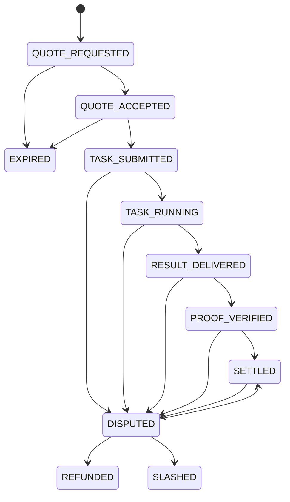

# NeuralClear Protocol Specification

Status: prototype draft.

## 0. Scope

NeuralClear defines clearing and trust semantics for AI agent service transactions. It does not define a new currency, custody user funds, or require a specific payment rail.

The protocol coordinates:

- agent identity and capability publication
- quotes and price commitments
- delegated spending mandates
- task submission and result delivery
- proof metadata
- settlement receipts
- disputes, refunds, and slashing states
- reputation records

Payment execution can happen through internal credits, card processors, bank rails, stablecoins, x402-style HTTP payments, or other adapters.

## 1. Roles

- `Owner`: the person, organization, wallet, or account that grants spending authority.
- `Buyer Agent`: the agent that requests quotes and submits tasks on behalf of an owner.
- `Provider Agent`: the agent that advertises capabilities, returns quotes, executes tasks, and delivers results.
- `Registry`: a directory or discovery service for agent manifests, capabilities, pricing, and reputation.
- `Ledger`: the clearing record that tracks settlement credits, transaction states, receipts, fees, and disputes.

NeuralClear does not require these roles to be operated by one party. A deployment can use a local in-memory ledger, a hosted clearing service, or an adapter to external payment infrastructure.

## 2. Protocol Objects

### AgentManifest

Published by a provider to describe identity, endpoint, public key, capabilities, pricing, and reputation. Providers should expose the manifest at:

```text
GET /.well-known/neuralclear/agent.json
```

### Capability

A named service the provider can perform, such as `summarize.pdf`, `search.web`, `review.code`, or `translate.text`. Capabilities should include resource and settlement pricing.

### Quote

A provider commitment that binds:

- provider
- capability
- resource estimate
- settlement price
- expiration time

Expired quotes must not be accepted.

### SpendingMandate

A bounded authorization from an owner to an agent. It controls allowed capabilities, per-task spend, daily spend, expiration, human approval thresholds, and signature metadata.

### TaskRequest

The buyer's request to execute a task after accepting a quote. It includes the quote id, capability, payload, and mandate.

### TaskResult

The provider's response, including output, resource usage, settlement amount, and proof metadata.

### Proof

Evidence metadata associated with a result. The prototype only includes `MockProof`; it is not a real attestation, signature proof, reproducibility proof, or ZK proof.

### Transaction

The clearing record for a service transaction. It tracks sender, receiver, amount, fee, quote id, capability, authorized agent, settlement time, and lifecycle state.

### SettlementReceipt

A durable record that a transaction was settled, disputed, refunded, or slashed. The current Python prototype records transactions in memory; the HTTP draft reserves a receipt object for hosted or persistent implementations.

### Dispute

A record opened when a buyer, provider, or clearing service challenges a transaction. Disputes can resolve to settlement, refund, or slashing.

## 3. Transaction Direction

`Transaction.amount > 0` means `sender` pays `receiver`.

The sender balance decreases by `amount + fee`. The receiver balance increases by `amount`. Fees, when present, increase `fee_pool`. No negative payment amounts are used to express direction.

## 4. Resource Metering And Settlement

NeuralClear separates metering from clearing:

- `ResourceUnit`: measures consumed or estimated resources, such as `tokens`, `gpu_seconds`, `bandwidth_mb`, `storage_mb`, or `request`.
- `SettlementCredit`: the clearing denomination used to debit and credit ledger accounts.

Example:

```json
{
  "resource_estimate": { "amount": 8000, "unit": "tokens" },
  "settlement_price": { "amount": 25, "currency": "CC" }
}
```

## 5. Agent Manifest

An agent manifest advertises:

- `agent_id`
- `name`
- `endpoint`
- `public_key`
- `capabilities`
- `pricing`
- `reputation`

The schema is defined in `schemas/agent_manifest.schema.json`. A full example is in `examples/agent_manifest.json`.

## 6. Mandate Validation

`SpendingMandate` solves the problem of an agent being authorized to spend money on behalf of an owner without receiving unlimited authority.

Fields:

- `owner`: the human, organization, wallet, or account granting authority
- `agent`: the delegated agent identity
- `allowed_capabilities`: capabilities the delegate may buy
- `max_per_task`: maximum settlement credit for one task
- `max_daily`: daily aggregate limit
- `valid_until`: expiration timestamp
- `requires_human_approval_above`: threshold where manual approval is required
- `signature`: signature over the mandate body

Minimal example:

```json
{
  "owner": "user.alice",
  "agent": "agent.alice.delegate",
  "allowed_capabilities": ["summarize.paper"],
  "max_per_task": { "amount": 30, "currency": "CC" },
  "max_daily": { "amount": 100, "currency": "CC" },
  "valid_until": 1790000000,
  "requires_human_approval_above": { "amount": 50, "currency": "CC" },
  "signature": "ed25519:demo-signature"
}
```

The prototype checks expiration, capability, currency, per-task limit, and in-memory daily spend. Real signature verification is intentionally left as future work.

Validation requirements:

- mandate must not be expired
- requested capability must be allowed
- settlement currency must match the mandate currency
- quote amount must be less than or equal to `max_per_task`
- current daily spend plus quote amount must be less than or equal to `max_daily`
- production implementations must verify the mandate signature before relying on it

## 7. Lifecycle State Machine

Transaction states:

- `QUOTE_REQUESTED`
- `QUOTE_ACCEPTED`
- `TASK_SUBMITTED`
- `TASK_RUNNING`
- `RESULT_DELIVERED`
- `PROOF_VERIFIED`
- `SETTLED`
- `DISPUTED`
- `REFUNDED`
- `SLASHED`
- `EXPIRED`

Allowed transitions:



## 8. Proof Model

`MockProof` is a local development placeholder. It must not be represented as a real TEE proof.

Proof levels:

- `NONE`
- `SIGNED_RESULT`
- `REPRODUCIBLE`
- `TEE_ATTESTATION`
- `ZK_PROOF`

Future implementations may attach provider signatures, reproducibility metadata, TEE attestation documents, or ZK proof artifacts.

## 9. Dispute Flow

A settled transaction cannot be refunded directly in this prototype. It must first enter `DISPUTED`, then resolve to one of:

- `REFUNDED`: buyer is made whole according to the deployment's refund policy
- `SLASHED`: provider is penalized according to the deployment's slashing policy
- `SETTLED`: the dispute is rejected or resolved in favor of settlement

The prototype models dispute states only; it does not implement arbitration, escrow, evidence review, or legal claims.

## 10. Strict Zero-Sum Clearing

`verify_zero_sum()` compares total balances plus `fee_pool` before and after settlement. There is no tolerance band.

For a transaction:

```text
sender_delta = -(amount + fee)
receiver_delta = amount
fee_pool_delta = fee
sender_delta + receiver_delta + fee_pool_delta = 0
```

Any fee must be explicit and must enter `fee_pool`.

## 11. Error Codes

The Python prototype raises `ProtocolError` for protocol failures. HTTP implementations should map failures to stable error codes:

- `QUOTE_EXPIRED`
- `INSUFFICIENT_CREDIT`
- `CAPABILITY_NOT_ALLOWED`
- `MANDATE_EXPIRED`
- `MANDATE_LIMIT_EXCEEDED`
- `MANDATE_CURRENCY_MISMATCH`
- `PROOF_VERIFICATION_FAILED`
- `INVALID_STATE_TRANSITION`
- `LEDGER_INVARIANT_FAILED`
- `UNKNOWN_AGENT`

## 12. HTTP Discovery Draft

Providers should expose an agent manifest at:

```text
GET /.well-known/neuralclear/agent.json
```

The draft HTTP API is described in `OPENAPI.yaml` and includes quote, task, settlement, and dispute endpoints.

## 13. Security Notes

Prototype limitations:

- no real custody
- no real payment execution
- no real signature verification
- no replay protection
- no production dispute resolution
- no real TEE attestation
- no real ZK proof verification
- no compliance, KYC, AML, sanctions, or tax controls

Production implementations must treat manifests, quotes, mandates, task payloads, proofs, receipts, and dispute evidence as security-sensitive records.

## 14. Non-Goals

NeuralClear is not:

- a bank
- a wallet
- a token issuer
- a money transmitter
- a replacement for MCP
- a replacement for A2A
- a replacement for AP2
- a replacement for x402
- a production financial system

## Appendix A. Opt-in Escrow Clearing Profile v1

This appendix is normative for `neuralclear-escrow-v1` only. Sections 0-14 describe
the legacy prototype; its SDK and HTTP API do not negotiate or implement this new
profile. Implementations MUST explicitly select this profile. `EscrowLedger` is
the reference implementation, not a replacement for the legacy `Ledger`.
Escrow here means reserved internal credits, not legal custody or Stripe escrow.

### A.1 Encoding and trust

All objects are JSON. Duplicate member names, unknown fields, floating-point
numbers, NaN, infinities and integers outside `[-9007199254740991,9007199254740991]`
MUST be rejected. Strings are restricted to ASCII U+0020 through U+007E in v1;
identifiers MUST be nonempty and exclude spaces. Unicode support requires a new
profile. Objects sort member names by ascending ASCII bytes, with no whitespace;
arrays retain order; booleans/null use JSON lowercase spelling; integers use decimal
without leading zeros. Escape only double quote as `\"` and backslash as `\\`.
Encode the result as ASCII/UTF-8 bytes. This is a restricted encoding, not JCS.

Hashes are SHA-256, lowercase 64-character hexadecimal. The meter genesis is 64
ASCII `0` characters. Domain separators below contain one trailing LF byte (0A).
HMAC keys are explicit nonempty raw byte strings configured out-of-band; no default
development key is accepted by this profile. `key_id` selects a trusted configured
key; a receipt MUST NOT provide its own trust anchor.

HMAC-SHA256 proves authenticity only to parties sharing the secret. Every verifier
holding the secret can also forge receipts. It is not public verification,
nonrepudiation, evidence of correct execution, TEE or ZK. Independent implementations
can verify with an authorized shared key, without access to the originating ledger.
Legacy MockProof remains test-only; legacy SignedResultProof/TEE/ZK types remain
unimplemented. Unsupported algorithm identifiers MUST be rejected, never downgraded.

### A.2 Escrow state and allocation

Each ledger is single-currency. Funding/credit conversion is outside this profile.
Transactions have distinct buyer/provider account identifiers, unique transaction
ID, non-negative integer service `budget` and `fee_limit`, and a fixed `unit` and
non-negative integer `rate` (credits per resource unit). Account issuance and total
supply MUST stay within the safe-integer range. No implicit FX or fiat peg exists.

All transitions in section 7 are supported; all other pairs MUST raise a protocol
error without changing balances, history, evidence or state. History starts with
QUOTE_REQUESTED. Each successful state transition appends its target; `revision`
is history length minus one. Meter appends are not state transitions.

* QUOTE_REQUESTED -> QUOTE_ACCEPTED reserves `budget + fee_limit` from buyer's
  spendable balance into that transaction's escrow. Insufficient credit rejects.
* Either permitted EXPIRED transition returns all reserved credits to buyer.
* TASK_RUNNING permits sequential meter records. A record costs `units * rate`;
  cumulative cost MUST NOT exceed budget. Other states reject meter appends.
* Entering DISPUTED freezes escrow: no task execution or metering can continue.
* PROOF_VERIFIED -> SETTLED and DISPUTED -> SETTLED/SLASHED require an explicit
  non-negative provider award (`amount`) and fee. Award MUST NOT exceed metered
  cost; fee MUST NOT exceed fee_limit; their sum MUST NOT exceed held escrow.
  The remaining escrow returns to buyer. SLASHED means a trusted arbitrator's
  reduced award; there is no penalty beyond the escrow or provider's allocation.
* DISPUTED -> REFUNDED returns ALL held escrow to buyer and requires zero award
  and fee. Neither REFUNDED nor SLASHED nor EXPIRED can transition again.
* SETTLED -> DISPUTED re-reserves exactly the last provider award and fee from
  the provider spendable balance and fee_pool. Previous buyer refunds stay with
  buyer. If the provider no longer has enough credit, reject atomically; this
  reference profile does not guarantee post-withdrawal dispute collateral.
  A subsequent resolution may distribute only this newly held amount. Repeated
  settlement/dispute cycles MUST NOT duplicate funds or refund prior refunds again.

Arbitrator selection, evidence assessment, and authorization of resolution calls
are application policy; a valid signature authenticates the decision, not its
fairness. PROOF_VERIFIED is an authorized caller assertion, not a claim that mock
proofs certify execution. `sum(spendable balances) + sum(held escrow) + fee_pool`
MUST equal issued supply after every operation. Validate before committing changes.
The in-memory reference implementation serializes mutations within one process.

### A.3 Meter record wire format

Exactly these fields are required (all monetary/count fields are non-negative
safe integers):

```json
{
  "transaction_id": "tx", "currency": "CC", "seq": 0,
  "previous": "0000000000000000000000000000000000000000000000000000000000000000",
  "units": 50, "unit": "request", "rate": 1, "amount": 50,
  "result_hash": "aaaaaaaaaaaaaaaaaaaaaaaaaaaaaaaaaaaaaaaaaaaaaaaaaaaaaaaaaaaaaaaa",
  "hash": "REPLACED_BY_COMPUTED_SHA256"
}
```

`seq` starts at zero with no gaps. `previous` is genesis or the preceding `hash`.
`amount = units * rate`. `transaction_id`, `currency`, `unit`, `rate` MUST match
the receipt. `result_hash` is SHA-256 of application result bytes (application
chooses and retains those bytes, not arbitrary reserialization of an object).
The example hash placeholder is illustrative; valid fixed vectors are below.
`hash = SHA256(ASCII("NeuralClear/meter/v1\n") || canonical(record without hash))`.
The receipt binds the entire ordered chain including its length and final digest.
The chain proves integrity of reported usage, not accuracy of real-world usage.

### A.4 Receipt wire format and verification

Exactly these fields are required:

| Fields | Types / semantics |
| --- | --- |
| profile | literal `neuralclear-escrow-v1` |
| transaction_id, buyer, provider, currency, unit | identifiers bound to the agreement |
| budget, fee_limit, rate | original non-negative integer terms |
| funded | budget+fee_limit if history includes QUOTE_ACCEPTED, otherwise zero |
| amount, fee, refund | cumulative final provider allocation, platform allocation and buyer return |
| state | SETTLED, REFUNDED, SLASHED or EXPIRED; unresolved evidence is not a final receipt |
| history, revision | array of state strings and length minus one |
| chain_head, chain_length | last meter hash (genesis if empty) and array length |
| result_hash | last meter result_hash, or genesis for empty chain |
| deltas | exactly buyer, provider, fee_pool, escrow integer entries (role names, not account IDs) |
| algorithm, key_id, signature | HMAC-SHA256 (64-hex MAC) or Ed25519 (128-hex signature), trusted key identifier |

The MAC input is `ASCII("NeuralClear/receipt/v1\n") || canonical(receipt without
signature)`. Algorithm and key ID ARE included. All fields are authenticated, not
just a whitelist. Compare MACs in constant time.

After checking schema, algorithm and MAC, verifiers MUST validate every history
edge, final state and revision, all meter record hashes, linkage, sequence, counts,
context and arithmetic. Nonempty chains require TASK_RUNNING in history. They MUST
also check `amount <= sum(meter.amount) <= budget`, `fee <= fee_limit`, and:

```text
amount + fee + refund = funded
deltas.buyer = -(amount + fee)
deltas.provider = amount
deltas.fee_pool = fee
deltas.escrow = 0
sum(deltas) = 0
```

REFUNDED and EXPIRED require amount=fee=0. These deltas describe cumulative
transaction effects relative to pre-reservation balances, not another instruction
to pay. A verifier MUST NOT apply receipt deltas to a ledger. Receipt identity is
the pair (transaction_id, revision); retain a trusted latest revision externally
when freshness matters. A previously valid receipt remains valid historical
evidence after a dispute. Neither this format nor HMAC alone proves global ledger
solvency, freshness, or absence of omitted transactions.

### A.5 Conformance vectors and CLI

`tests/fixtures/escrow_v1.json` contains complete JSON cases: setup balances,
transaction terms, ordered operations, expected snapshot, receipt, meter chain,
and valid/invalid verification outcomes. `key_hex` is a public test-only key.
Other implementations MUST reproduce exact meter hashes and MACs, and reject
every negative vector. Frozen expected outputs must not be regenerated by tests.

Reference CLI (the key file contains raw key bytes, without an added newline):

```sh
python -m neuralclear.verify receipt.json chain.json --key-id test --key-file secret.key
```

Success prints VALID and exits 0; invalid evidence/input prints INVALID and exits
1; malformed command arguments exit 2. No network or Ledger instance is required.
The extensions below define recovery, signed authorization and opt-in HTTP transport.

### A.6 Algorithms and signed results

The existing wire field is named `algorithm` (not a second ambiguous `alg` field).
Supported values are `HMAC-SHA256` and `Ed25519`. Trust configuration binds each
key_id to ONE algorithm and key; reject any mismatch. Raw legacy verifier key bytes
mean HMAC only. Ed25519 keys for verification are raw 32-byte public keys, never
seeds. Signing accepts a 32-byte seed. Use pure Ed25519 from RFC 8032 (not ctx/ph)
over the same receipt domain-separated bytes in A.4. Signatures are lowercase hex.
Reject non-canonical points, S >= subgroup order, identity and non-prime-subgroup
public/R points. RFC 8032 section 7.1 tests 1-3 are included in test_ed25519.py.
The reference Python bigint signer is NOT constant-time or production-hardened.

Signed result objects contain exactly transaction_id, result_hash, algorithm,
key_id, signature. Sign the canonical unsigned object with domain
`NeuralClear/result/v1\n`. The workflow hashes canonical(result) bytes using plain
SHA-256; the verifier MUST match both transaction_id and the recomputed result hash.
The receipt's final result_hash MUST match the final metered result. Signature
verification establishes the configured provider's statement, not service quality
or correct execution. TEEVerifier and ZKVerifier are interfaces only, with no
implementation. All legacy Proof classes remain unchanged; mock is test-only.

### A.7 Append-only journal and trusted checkpoint

EscrowLedger accepts optional journal_path and checkpoint. Without them it remains
in-memory. The checkpoint is an independently trusted service implementing read()
and atomic compare_and_set(old, new); its value is exactly {count, hash}. Genesis
is count=0 and the zero hash. The operator MUST durably retain the latest checkpoint
outside the log's rollback/tampering trust boundary. A checkpoint copied beside an
attacker-writable log is NOT a trusted anchor. The test checkpoint is in-memory and
is deliberately not a production checkpoint service.

Each LF-terminated journal line is canonical JSON with exactly seq, previous,
currency, method, args, kwargs, at, hash. seq starts at zero; at is integer Unix
seconds captured by the ledger clock. hash is SHA256 of
`NeuralClear/journal/v1\n` followed by the canonical object excluding hash. The
method names and positional/keyword arguments describe the reference Python
mutation API, not an interoperable transport command. Cross-language receipt and
meter verification uses A.1-A.6; a different implementation may use its own journal.

Recovery validates every line, link, sequence, currency and digest, then requires
exact agreement with the trusted count/head BEFORE replaying allowed operations.
Replay uses the recorded event time and revalidates operations. Unknown operations,
partial lines, truncated logs, and mismatched checkpoints are rejected. Changing a
whole suffix and recomputing hashes cannot defeat an unchanged trusted checkpoint.

The reference journal holds an exclusive OS file lock for its lifetime (POSIX).
Mutations use one reentrant lock; validation, budget reservation and escrow changes
are serialized and rolled back in memory on failure. Successful outer operations
append one event, fsync the log and advance the checkpoint before returning. Nested
operations are one journal transaction. A crash between log fsync and checkpoint
commit fails closed on reopening; reconcile explicitly, never truncate or auto-trust
the log. I/O/checkpoint failure poisons the writer until reconciliation/reopen.
This is single-writer, not a distributed consensus or high-availability design.

### A.8 Signed mandates and budget accounting

The escrow mandate wire shape is distinct from legacy nested SettlementCredit:

```json
{
  "profile": "neuralclear-escrow-v1", "mandate_id": "m1",
  "owner": "buyer", "agent": "research", "currency": "usd",
  "allowed_capabilities": ["summarize"],
  "max_per_task": 100, "max_daily": 1000, "max_total": 2000,
  "valid_until": 2000000000, "requires_human_approval_above": 100,
  "algorithm": "Ed25519", "key_id": "owner", "signature": "ILLUSTRATIVE"
}
```

These are exactly the required fields. All amounts and timestamps are non-negative
safe integers. Sign canonical unsigned mandate with `NeuralClear/mandate/v1\n`.
Trust configuration binds key_id to owner, algorithm and verification key. A buyer
cannot self-assert a different owner's authority. Bind transaction to mandate_id,
delegate and capability before acceptance. Validate signature, owner=buyer, agent,
currency, capability, expiry (now >= valid_until rejects), per-task amount including
fees, and approval threshold. Above threshold the reference refuses execution;
an authenticated owner must issue a newly signed mandate with appropriate authority.
There is no caller-supplied approval boolean.

Mandate ID is immutable; changed content conflicts. Revocation is a journaled
trusted owner/admin operation, irreversible for that ID. Check the revocation
registry and expiry at acceptance, submission, running, delivery, proof transition,
and each metering append. Revocation cannot claw back work already executed; it
blocks new execution while allowing dispute/return of held funds.

At acceptance atomically reserve budget+fee_limit against both max_total and
max_daily. Counters are scoped to mandate_id; issuing another ID is a new explicit
owner grant, not implicit replenishment. Daily bucket is UTC floor(accept_time/86400),
including pending reservations until closed, even across midnight. Closing replaces
the reservation with actual award+fee in that same bucket; unused budget returns.
Refund/expiry frees the relevant amount. Total cap spans days. Reopened disputes
retain previously spent allocation until resolution. One ledger lock serializes
concurrent reservations and revocations; all counters replay from the journal.

### A.9 Escrow HTTP negotiation and errors

`server.escrow_api.create_escrow_app` creates a separate opt-in app; an operator can
mount it at /escrow or deploy it independently. It does not modify legacy routes.
GET /.well-known/neuralclear/agent.json advertises profile, version, currency,
signature_algorithms and implemented proof level. All other requests require:

```text
X-NeuralClear-Profile: neuralclear-escrow-v1
X-NeuralClear-Version: 1
X-NeuralClear-API-Key: <operator-provisioned write key for POST>
```

Responses echo both version headers. Unsupported/missing version or profile returns
406 UNSUPPORTED_VERSION. Missing/invalid write credentials returns 401 UNAUTHORIZED.
Protocol failures return {error:{code:CODE},profile,version}; invalid transitions and
conflicts return 409, other protocol/validation errors 400. Codes in section 11 are
used for corresponding quote expiry, credit, capability, mandate currency/expiry/
limit, signature, state, invariant and agent errors. Extensions: MANDATE_REVOKED,
MANDATE_INVALID, UNKNOWN_TRANSACTION, CONFLICT, INVALID_REQUEST. Clients MUST use
codes, not free-text messages. Old HTTP error behavior is unchanged.

Supported reference routes: POST /neuralclear/quote (quote, signed mandate, agent,
capability); POST /neuralclear/tasks (transaction_id, starts pre-funded task);
GET /neuralclear/tasks/{task_id}; POST /neuralclear/disputes (transaction_id);
GET /neuralclear/receipts/{receipt_id} (receipt plus chain). Funding, metering,
arbitration and payout are trusted SDK/operator operations, not arbitrary public
money-movement endpoints. This is an explicit limited transport surface, not a
multi-tenant hosted service or authenticated per-user identity system.

### A.10 Integrated channel workflow

NeuralClearSDK(..., profile="neuralclear-escrow-v1").escrow() returns the opt-in
workflow; default SDK behavior remains legacy. ClearingLedger implements the Stripe
port in integer fiat minor units; it never converts CC. Prepare signed authorization,
create PaymentIntent, then re-fetch succeeded state through StripeChannel. Deposit
deduplication and issuance+escrow reservation are one atomic journal operation.
Duplicate callbacks cannot issue twice. Metered service allocates net amount once;
disputes freeze allocations, then partial awards release unused credits to buyer.

Payout reserves the provider allocation in a non-tradable internal account. Once
reserved, the transaction cannot reopen; failed/unknown payouts require explicit
reconciliation. The reference refuses repeat payout POSTs even with the same key,
including after restart, to avoid relying on Stripe's finite idempotency retention.
Pending/failed payouts keep funds reserved; paid removes the reservation and reduces
outstanding supply exactly once. Trust bindings select the provider's connected
account. Transfer/payout IDs, amounts and destination are checked and journaled.
Buyer refunds here return internal credits, NOT a Stripe card refund. External
chargebacks, crash-between-remote-steps reconciliation, and post-payout collateral
are operator responsibilities, not silently automated.

Signed receipts describe internal clearing allocations, not proof that a bank paid.
`examples/escrow_channel_demo.py` runs normal and partially disputed transactions
with fake urllib HTTP only, exports public-key-verifiable receipts/chain, and is
covered by tests/test_escrow_channel_e2e.py with an independent verifier subprocess.

### A. Strict evidence policy (opt-in, 2026-10-22)

NeuralClear is a clearing-semantics engine plus channel adapters. Custody and
compliance are licensed-partner responsibilities, not properties of this ledger.
See [deployment routes](docs/custody-boundaries.md).

`StrictEscrowLedger` is an opt-in escrow-v1 engine policy, not a change to legacy
or the default HTTP deployment. Configure trusted arbitrator Ed25519 keys,
quorum k (default 1), and provider->key mappings before opening a journal.
Configuration must be preserved on recovery and controlled out-of-band.

Only `meter_verified(tx, units, result, proof)` can add strict meter entries.
The result signature uses Appendix A's result domain and binds transaction ID
and canonical result hash. Provider keys are scoped to the transaction provider.
Mock, unsigned, TEE and ZK placeholders are rejected. Signatures do not prove
honesty or resource usage; trusted providers can still lie about execution.

Disputed funds stay frozen until `resolve(decision, signatures)`. A decision has
exactly: decision_id, transaction_id, revision, currency, chain_head,
chain_length, evidence, amount, fee, policy. Policy is `signed-metered-v1`.
Evidence is the complete ordered list of `{seq, hash}` for the frozen chain.
An empty chain requires an explicit empty evidence list, zero length and the
all-zero head. This is the no-delivery refund exception, not missing evidence.
Amount is the sum of accepted meter amounts; fee is zero. Thus partial delivery
releases metered units times agreed rate and refunds the remaining held credits;
zero delivery refunds everything. This is not subjective quality arbitration.

Each arbitrator signs the complete decision using Ed25519 and domain
`NeuralClear/decision/v1\n`, followed by canonical JSON including algorithm and
key_id but excluding signature. k distinct configured public keys must approve;
aliases of the same public key are rejected at configuration time. Decision IDs
are ledger-global and single-use; revision and frozen chain prevent stale awards.
The journal stores the complete signed decision; `decision_record` exports it.
Legacy receipt shape is unchanged: it authenticates monetary allocation, while
arbitrator evidence remains a separate record, not a receipt quorum certificate.

Merkle inclusion uses SHA256(0x00 || canonical(entry)) for leaves and
SHA256(0x01 || left32 || right32) for parents; odd nodes duplicate the last node.
Proof fields: index, count, siblings (bottom-up lowercase hex), root. The entry
sequence must equal index. Empty trees have no inclusion proof. A root supplied
by an untrusted prover is insufficient. `verify_meter_inclusion` first verifies
the signed receipt and complete chain, derives its root, then checks inclusion.
This version is integrity evidence, not succinct root-only execution attestation.

`wait_for_writer=True` selects POSIX blocking file-lock ownership for a ledger
session. Acquire before replay; keep the lock through budget validation, journal
append/fsync, checkpoint CAS and close. Each worker MUST close its session before
another can proceed. Default nonblocking single-writer behavior is unchanged.
There is no stale concurrent writer, fairness guarantee, distributed consensus
or network-filesystem guarantee. A crash between log and checkpoint remains
fail-closed and requires reconciliation. Protected checkpoints remain required.

Connect preflight is read-only: inspect platform and connected-account list.
An empty list cannot distinguish a newly enabled platform from an unregistered
one; fail closed unless an operator explicitly confirms activation. Existing
accounts provide evidence of prior use, not a guarantee of current creation or
payout eligibility. Errors direct operators to dashboard.stripe.com/connect.
USDC is an interface only; no token transfers or compliance implementation ship.
